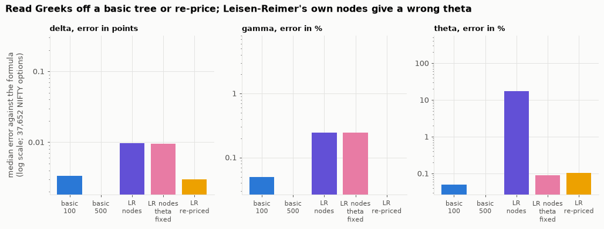

# Binomial Trees

[](https://github.com/Dhirajdas18/binomial-trees/actions/workflows/ci.yml)
[](https://dhirajdas18.github.io/binomial-trees/)

Binomial (and later trinomial) option-pricing trees, from a single up-or-down step to trees fitted
to the NIFTY smile: Cox-Ross-Rubinstein and its convergence to Black-Scholes, Greeks from the tree,
American early exercise, NSE dividends and barriers.

**Live tree lab: [dhirajdas18.github.io/binomial-trees](https://dhirajdas18.github.io/binomial-trees/)**,
set the share price, strike, volatility, days, rate and dividend yield, and see the tree itself
with the option value at every node, where early exercise pays, and how the tree price converges
to Black-Scholes as the steps grow; all computed in the browser.

## Features

- [x] One step to many: replication, risk-neutral probability, CRR and its convergence to Black-Scholes
- [x] Greeks from the tree
- [x] American options: the early-exercise premium and boundary
- [ ] Discrete cash dividends on NSE stocks
- [ ] Trinomial trees and barrier options
- [ ] An implied tree fitted to the NIFTY smile
- [ ] Does a smile-fitted tree hedge better than Black-Scholes

## Findings

### 1. Leisen-Reimer priced every NIFTY option to the tick by 51 steps; the basic tree needed thousands

<a href="docs/img/convergence.png"><picture><source media="(prefers-reduced-motion: reduce)" srcset="docs/img/convergence.png"></picture></a>

<a href="docs/img/convergence_real.png"><picture><source media="(prefers-reduced-motion: reduce)" srcset="docs/img/convergence_real.png"></picture></a>

One step first: with the price going up ×1.1 or down ÷1.1 and a strike of 100, holding 0.5238
shares and borrowing ₹47.62 pays exactly what the call pays, so the call costs ₹4.76, the same as
the risk-neutral chance of an up move, 0.4762, times the ₹10 payoff. Many steps chain these into the
Cox-Ross-Rubinstein (CRR) tree. Two refinements are tested against it: averaging the n- and
(n + 1)-step prices, and Leisen-Reimer, which places the tree's nodes around the strike. The target
is Black-Scholes; on real data, every traded out-of-the-money NIFTY option on the last trading day
of each month, January 2015 to November 2026 (37,652 options, 7–365 days), priced on its forward
with that day's fitted volatility at its strike (from implied-vol-surface's local data), so Black-76
is the exact answer. Accuracy is counted against NSE's price step, one tick of ₹0.05.

- **Leisen-Reimer was exact in tens of steps.** It priced 98.2% of the real options within a tick
  at 25 steps and all of them at 51 (largest error ₹0.03); at 101 steps its median error was
  ₹0.0008.
- **The basic tree needed thousands.** CRR priced 17.2% within a tick at 100 steps, 60.6% at 500
  and 95.9% at 2,000. Its error halved each time the steps doubled; Leisen-Reimer's fell to about a
  quarter.
- **Averaging fixed the at-the-money zig-zag, not the rest.** At the money CRR's error flips sign
  between odd and even steps (−1.07 at 100 steps for a 30-day call worth ₹427), and the average
  cut it to −0.004. For a 10% out-of-the-money put it barely helped (−0.18 to −0.15): there the
  error follows where the strike falls between nodes. Across the real options at 100 steps the
  average halved the median error within 2% of the forward (₹0.37 to ₹0.19) and did nothing
  beyond 10% (₹0.10 to ₹0.11); it needed 1,000 steps for 96.4% within a tick.

### 2. Greeks read off a basic tree were accurate; Leisen-Reimer's own nodes gave a wrong theta

<a href="docs/img/greeks.png"><picture><source media="(prefers-reduced-motion: reduce)" srcset="docs/img/greeks.png"></picture></a>

A tree gives Greeks for free from its first two steps: delta from the two prices one step ahead,
gamma from the three two steps ahead, theta from the middle two-step price against today's. Each
way is scored against the Black-Scholes (Black-76) formulas on finding 1's 37,652 NIFTY options:
basic CRR trees of 100 and 500 steps, a 101-step Leisen-Reimer tree read the same way, the same with
its theta moved back to today's price (a second-order Taylor step), and the Leisen-Reimer price
recomputed with NIFTY moved ±0.5% and one day later.

- **The basic tree's own Greeks were accurate.** At 100 steps the median errors were 0.028 delta
  points, 0.41% of gamma and 0.41% of theta (₹0.011 a day); at 500 steps 0.005 points, 0.08% and
  0.08%.
- **Leisen-Reimer's nodes gave a theta off by 142%.** Its middle two-step node is not at today's
  price (its up and down moves don't cancel), so comparing the two prices mixes a price move into
  the time decay. Moving it back to today's price cut the error to 0.72%. Its delta (0.080 points)
  and gamma (2.0%) read off the nodes were also worse than the basic tree's, and the Taylor step did
  not fix delta.
- **Re-pricing Leisen-Reimer worked.** Recomputing its price with NIFTY moved and a day later gave
  0.024 delta points, 0.09% of gamma and 0.85% of theta.

### 3. If NIFTY's puts were American, most would be worth a little more; its calls nothing

<a href="docs/img/american.png"><picture><source media="(prefers-reduced-motion: reduce)" srcset="docs/img/american.png"></picture></a>

NSE's options are European, so this is a what-if: an American option may be exercised on any day,
and a tree handles that by taking, at every node, the larger of holding on and exercising now.
Finding 1's NIFTY options are priced both ways on 201-step Leisen-Reimer trees, on NIFTY's close
with the day's volatility at each strike, a 6.5% rate and a 1.3% dividend yield (the median implied
by each expiry's forward against the close; the per-expiry figures are noisy because the close and
option prices are taken at different moments). The premium is American minus European.

- **83% of the puts would be worth over a tick more.** The median premium was ₹0.67, 1.2% of the
  European price; 1.7% for strikes 0–5% below NIFTY and 4.1% for those above it, 0.6% more than 10%
  below. It grew with time to expiry: 0.5% at 7–15 days, 3.9% at 91–365.
- **The calls would be worth nothing more.** Every call in the set is out of the money and NIFTY's
  dividend yield is below the rate, so exercising early never beat holding.
- **Exercise only after a deep fall.** With a year left, a put on NIFTY is worth exercising once the
  index is below 90.8% of the strike at 12% volatility, 83.8% at 18% and 75.6% at 25%; with 30 days
  left, 95.2%, 91.7% and 88.2%.
- **The rate drives the premium.** An at-the-money 91-day put at 15% volatility gains nothing with a
  zero rate, 5.1% at 6.5% and 14.8% at 12%; a one-year put 15.5% at 6.5%.

## Quick start

```bash
uv sync
uv run btree report <topic>             # a study's numbers and charts -> out/
                                        # (topics: convergence, greeks, american)
uv run python scripts/build_site.py     # tree lab -> site/index.html (code only, no data)
uv run pytest
```

The lab and the tests need no market data; the tests of the browser maths need Node. Studies on
real NIFTY options read implied-vol-surface's local data (its daily SVI table and NSE option rows;
set `BTREE_IV_DIR` if that repo is not at `~/quant-learn/implied-vol-surface`) and NIFTY's close from
the NSE bhavcopy archive (`BTREE_LAKE_DIR` or `IV_LAKE_DIR`); nothing from NSE is committed here.

## Design

- `src/btree/tree.py`: the core maths in numpy (scipy only for the normal CDF): Black-Scholes with
  a continuous dividend yield as the closed-form reference; the Cox-Ross-Rubinstein tree
  (u = e^{σ√Δt}, d = 1/u, p = (e^{(r−q)Δt} − d)/(u − d), checked to lie in (0, 1)) with backward
  induction vectorised per step and American exercise at every node; `crr_tree` with the stock
  price, option value and early-exercise flag at every node (n ≤ 50); delta, gamma and theta from
  the step-1 and step-2 nodes; prices over a range of n, the n and n + 1 average, and
  Leisen-Reimer (Peizer-Pratt method 2, odd n).
- `src/btree/tree.js`: the lab's browser copy of the tree, Black-Scholes (with a double-precision
  normal CDF) and Leisen-Reimer, tested against Python through Node to 1e-9.
- `src/btree/batch.py`: European tree prices for many options at once as the discounted binomial
  average of payoffs (equal to backward induction, tested), for CRR and Leisen-Reimer; Greeks from
  the first two steps (with an optional move back to today's price) or by re-pricing, and the
  Black-Scholes Greeks; American prices for many options at once and the early-exercise boundary.
- `src/btree/data.py`: month-end NIFTY option cases from implied-vol-surface's local data.
- `src/btree/reports.py`: README findings, reproducible with `btree report <topic>`.
- `src/btree/site.py`: the tree lab, one static Plotly page built from code alone.
- `src/btree/plots.py`: the shared chart style and the animated README charts.
- Conventions: time to expiry is calendar days / 365; rates and dividend yields are continuously
  compounded, a year; prices in rupees; node j at step i has j up moves.
- Charts: one validated palette; README charts are animated GIFs with a static fallback for
  reduced-motion users.

Research only, not investment advice. MIT licence.
