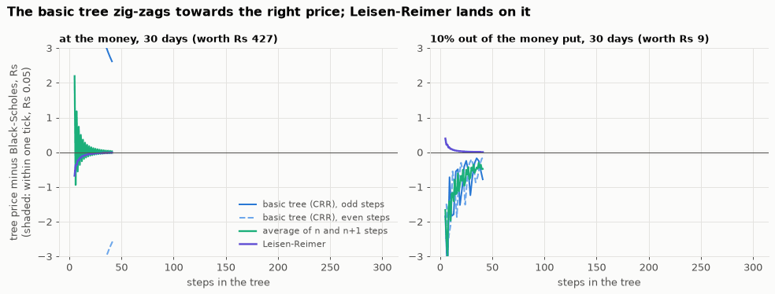
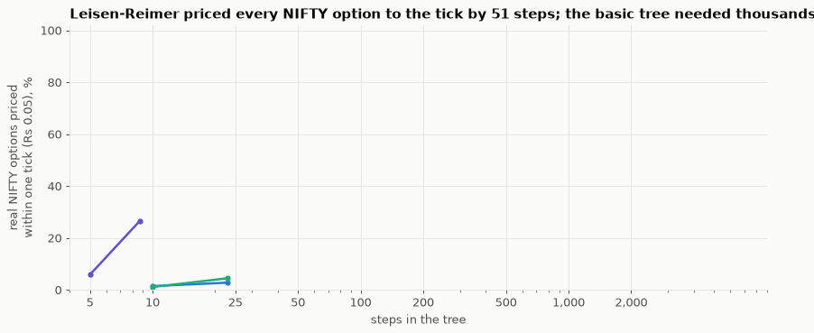
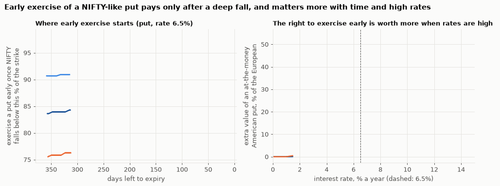
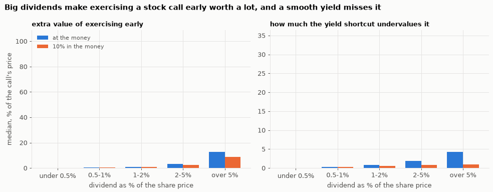
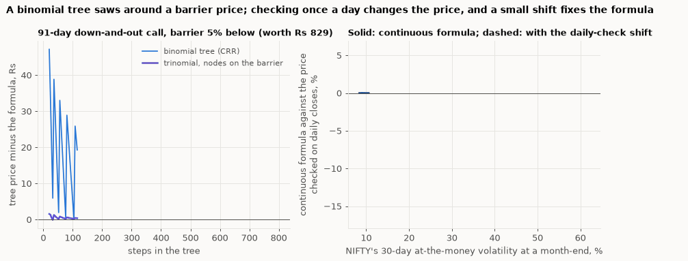
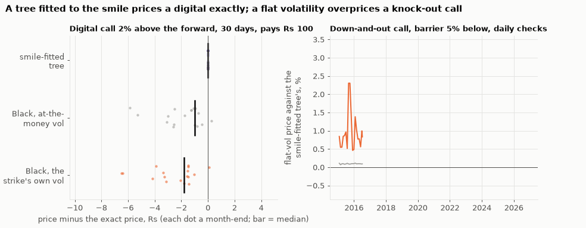
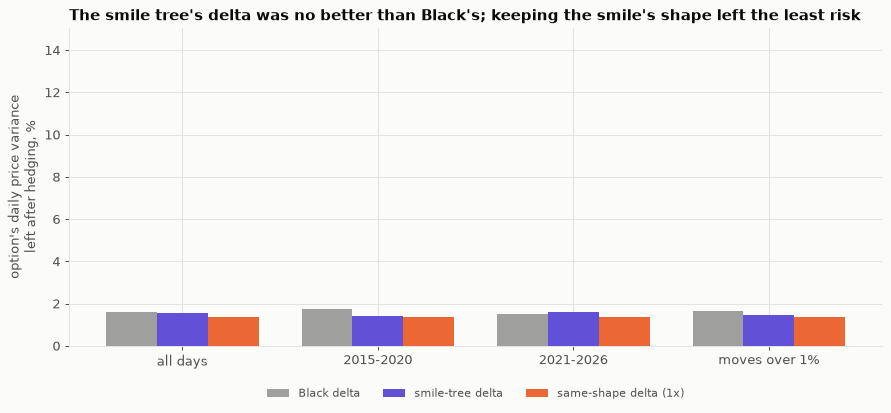

# Binomial Trees

[](https://github.com/Dhirajdas18/binomial-trees/actions/workflows/ci.yml)
[](https://dhirajdas18.github.io/binomial-trees/)

Binomial and trinomial option-pricing trees, from a single up-or-down step to trees fitted
to the NIFTY smile: Cox-Ross-Rubinstein and its convergence to Black-Scholes, Greeks from the tree,
American early exercise, NSE dividends and barriers.

**Live tree lab: [dhirajdas18.github.io/binomial-trees](https://dhirajdas18.github.io/binomial-trees/)**,
set the share price, strike, volatility, days, rate and dividend yield, and see the tree itself
with the option value at every node, where early exercise pays, and how the tree price converges
to Black-Scholes as the steps grow; all computed in the browser.

## Features

- [x] One step to many: replication, risk-neutral probability, CRR and its convergence to Black-Scholes
- [x] Greeks from the tree
- [x] American options: the early-exercise premium and boundary
- [x] Discrete cash dividends on NSE stocks
- [x] Trinomial trees and barrier options
- [x] An implied tree fitted to the NIFTY smile
- [x] Does a smile-fitted tree hedge better than Black-Scholes

## Findings

### 1. Leisen-Reimer priced every NIFTY option to the tick by 51 steps; the basic tree needed thousands

<a href="docs/img/convergence.png"><picture><source media="(prefers-reduced-motion: reduce)" srcset="docs/img/convergence.png"></picture></a>

<a href="docs/img/convergence_real.png"><picture><source media="(prefers-reduced-motion: reduce)" srcset="docs/img/convergence_real.png"></picture></a>

One step first: with the price going up ×1.1 or down ÷1.1 and a strike of 100, holding 0.5238
shares and borrowing ₹47.62 pays exactly what the call pays, so the call costs ₹4.76, the same as
the risk-neutral chance of an up move, 0.4762, times the ₹10 payoff. Many steps chain these into the
Cox-Ross-Rubinstein (CRR) tree. Two refinements are tested against it: averaging the n- and
(n + 1)-step prices, and Leisen-Reimer, which places the tree's nodes around the strike. The target
is Black-Scholes; on real data, every traded out-of-the-money NIFTY option on the last trading day
of each month, January 2015 to November 2026 (37,652 options, 7–365 days), priced on its forward
with that day's fitted volatility at its strike (from implied-vol-surface's local data), so Black-76
is the exact answer. Accuracy is counted against NSE's price step, one tick of ₹0.05.

- **Leisen-Reimer was exact in tens of steps.** It priced 98.2% of the real options within a tick
  at 25 steps and all of them at 51 (largest error ₹0.03); at 101 steps its median error was
  ₹0.0008.
- **The basic tree needed thousands.** CRR priced 17.2% within a tick at 100 steps, 60.6% at 500
  and 95.9% at 2,000. Its error halved each time the steps doubled; Leisen-Reimer's fell to about a
  quarter.
- **Averaging fixed the at-the-money zig-zag, not the rest.** At the money CRR's error flips sign
  between odd and even steps (−1.07 at 100 steps for a 30-day call worth ₹427), and the average
  cut it to −0.004. For a 10% out-of-the-money put it barely helped (−0.18 to −0.15): there the
  error follows where the strike falls between nodes. Across the real options at 100 steps the
  average halved the median error within 2% of the forward (₹0.37 to ₹0.19), did not help at
  10–20% (₹0.10 to ₹0.11) and was slightly worse beyond 20% (₹0.15 to ₹0.17); it needed 1,000
  steps for 96.4% within a tick.

### 2. Greeks read off a basic tree were accurate; Leisen-Reimer's own nodes gave a wrong theta

<a href="docs/img/greeks.png"><picture><source media="(prefers-reduced-motion: reduce)" srcset="docs/img/greeks.png"></picture></a>

A tree gives Greeks for free from its first two steps: delta from the two prices one step ahead,
gamma from the three two steps ahead, theta from the middle two-step price against today's. Each
way is scored against the Black-Scholes (Black-76) formulas on finding 1's 37,652 NIFTY options:
basic CRR trees of 100 and 500 steps, a 101-step Leisen-Reimer tree read the same way, the same with
its theta moved back to today's price (a second-order Taylor step), and the Leisen-Reimer price
recomputed with NIFTY moved ±0.5% and one day later.

- **The basic tree's own Greeks were accurate.** At 100 steps the median errors were 0.028 delta
  points (delta × 100, so per 100 units of NIFTY), 0.41% of gamma and 0.41% of theta (₹0.011 a day); at 500 steps 0.005 points, 0.08% and
  0.08%.
- **Leisen-Reimer's nodes gave a theta off by 142%.** Its middle two-step node is not at today's
  price (its up and down moves don't cancel), so comparing the two prices mixes a price move into
  the time decay. Moving it back to today's price cut the error to 0.72%. Its delta (0.080 points)
  and gamma (2.0%) read off the nodes were also worse than the basic tree's, and the Taylor step did
  not fix delta.
- **Re-pricing Leisen-Reimer worked.** Recomputing its price with NIFTY moved and a day later gave
  0.024 delta points, 0.09% of gamma and 0.85% of theta.

### 3. If NIFTY's puts were American, most would be worth a little more; its calls nothing

<a href="docs/img/american.png"><picture><source media="(prefers-reduced-motion: reduce)" srcset="docs/img/american.png"></picture></a>

NSE's options are European, so this is a what-if: an American option may be exercised on any day,
and a tree handles that by taking, at every node, the larger of holding on and exercising now.
Finding 1's NIFTY options are priced both ways on 201-step Leisen-Reimer trees, on NIFTY's close
with the day's volatility at each strike, a 6.5% rate and a 1.3% dividend yield for every year (the
2015–2026 median implied by each expiry's forward against the close; the per-expiry figures are
noisy because the close and option prices are taken at different moments). The premium is American minus European.

- **83% of the puts would be worth over a tick more.** The median premium was ₹0.67, 1.2% of the
  European price; 1.7% for strikes 0–5% below NIFTY and 4.1% for those above it, 0.6% more than 10%
  below. It grew with time to expiry: 0.5% at 7–15 days, 3.9% at 91–365.
- **The calls would be worth nothing more.** Every call in the set is out of the money, far from
  where an American call would be exercised (with a 1.3% yield that takes a deep in-the-money call:
  a one-year call struck at 16% of NIFTY's level would carry a ₹71 premium, one struck at 40%
  nothing).
- **Exercise only after a deep fall.** With about a year left, a put on NIFTY is worth exercising
  once the index is below 90.7% of the strike at 12% volatility, 83.6% at 18% and 75.5% at 25%; with
  30 days left, 95.1%, 91.8% and 88.0% (boundary smoothed over 41 steps).
- **The rate drives the premium.** An at-the-money 91-day put at 15% volatility gains nothing with a
  zero rate, 5.1% at 6.5% and 14.8% at 12%; a one-year put 15.5% at 6.5%.

### 4. Before a big dividend, exercising a stock call early is worth a lot, and a smooth yield misses it

<a href="docs/img/dividends.png"><picture><source media="(prefers-reduced-motion: reduce)" srcset="docs/img/dividends.png"></picture></a>

NSE stocks pay cash dividends on known dates, and the share price drops by about the dividend on
the ex-date. An American call holder can exercise the day before to collect it. For every dividend
Yahoo records for today's F&O stocks (3,191 dividends on 202 of 218 stocks, April 2014–November
2026; median 0.61% of the price), a call is struck 30 days before the ex-date and expires 10 days
after it, at the money and 10% in the money, on that day's close with the previous 60 days'
volatility (median 30.2%) and a 6.5% rate. Prices come from an escrowed-dividend tree (the
dividend's present value is taken out of the price that moves, and added back at each node; 201-step
Leisen-Reimer), as American and European; the shortcut spreads the same dividend as a continuous
yield. The dividend's amount and date are treated as known 30 days ahead, which is often before
the company announces them. Today's F&O list only, so stocks that left it are missing. NSE's stock
options are European: this is a what-if.

- **Most calls would be worth exercising early.** For 86% of the 10%-in-the-money calls the right
  was worth over a tick, a median 2.6% of the European price (2.1% at the money).
- **It grew with the dividend.** For 10%-in-the-money calls the premium was 0.4% for dividends under
  0.5% of the price, 8.3% at 1–2%, 21.7% at 2–5% and 71.1% above 5%; at the money, 104% above 5%.
- **The yield shortcut got the American price wrong, not the European.** Spread as a yield, the
  dividend left European prices unchanged (to ₹0.000001) but undervalued the American call by a
  median 2.4% (10% in the money; 1.9% at the money), 7.1% and 15.2% for dividends of 2–5%, and
  34.7% at the money above 5%.

### 5. A binomial tree saws around a barrier price; a trinomial tree with nodes on the barrier doesn't

<a href="docs/img/barriers.png"><picture><source media="(prefers-reduced-motion: reduce)" srcset="docs/img/barriers.png"></picture></a>

A down-and-out call is a call that dies if the price touches a barrier below today's level. NSE
lists no barrier options, so this is calculation on NIFTY-like terms: strike at today's level,
barrier 5% below, 91 days, 15% volatility, 6.5% rate, 1.3% yield, against the continuous-barrier
formula. The binomial tree kills every node at or below the barrier; Ritchken's trinomial tree (up,
middle or down at each step) stretches its spacing so a row of nodes sits exactly on the barrier.
Then the same option over 30 days, checked only on 21 daily closes (a trinomial tree that checks the
barrier every hundredth of its 2,100 steps), at each of 143 month-ends' real 30-day at-the-money NIFTY
volatility (8.4%–62.0%), against the continuous formula and the formula with Broadie, Glasserman
and Kou's shift of the barrier (×e^{−0.5826σ√Δt}).

- **The binomial tree never settled.** Against a formula price of ₹828.53 its error was +₹4.80 at
  100 steps and +₹7.76 at 800, and swung between −₹0.06 and +₹15.65 from 400 to 800 steps: the
  barrier usually falls between node levels, and which level the tree treats as the barrier moves
  with the step count.
- **The aligned trinomial converged.** Its error was +₹0.27 at 100 steps and +₹0.06 at 800; from 400
  to 800 steps it stayed between −₹0.03 and +₹0.12, against −₹0.06 to +₹15.65 for the binomial tree.
- **Checking once a day mattered when NIFTY was volatile.** With the barrier 5% below, the
  continuous formula priced the daily-checked option a median 0.2% too low, but up to 20.1% too low
  at 62% volatility (10% below: up to 6.1%). The shifted barrier cut the median gap to 0.01% and the
  largest to 1.6% (10% below: 0.5%).

### 6. A tree fitted to NIFTY's smile priced a digital to within a paisa at the median; a flat volatility overpriced a knock-out call

<a href="docs/img/smile_tree.png"><picture><source media="(prefers-reduced-motion: reduce)" srcset="docs/img/smile_tree.png"></picture></a>

Derman and Kani's implied tree bends a tree so it re-prices every option on the smile; built
directly it often needs negative probabilities. The stable form used here: at each of 143
month-ends, the day's SVI slices give Dupire's local volatility (the volatility the price must have
at each level and date to produce the smile; total variance interpolated in time between slices),
run on a 1,260-step trinomial grid 30 days ahead. Local variance is capped at nine times the
at-the-money variance, which only binds in the far wings and keeps the grid fine. A digital call (pays ₹100 if NIFTY ends
above 102% of the forward) has an exact price from the smile's slope; the down-and-out call
(strike at the forward, barrier 5% below, checked on 21 daily closes) has none, so the smile tree is
compared with the same tree at a flat at-the-money volatility.

- **The tree re-priced the smile.** At four strikes on each day's 30-day smile (8% and 4% below,
  at, and 3% above the forward) its error
  had a median of ₹0.31 (0.19 basis points of the forward), 90th percentile ₹0.97; above ₹2 in 4
  of 143 month-ends.
- **It priced the digital closely; Black did not.** Against an exact median of ₹31.05, the smile
  tree's error had a median of −₹0.006 (largest ₹4.50). Black's formula was ₹0.97 too low with the at-the-money
  volatility and ₹1.79 too low with the strike's own volatility, which leaves out the smile's
  slope.
- **A flat volatility overpriced the knock-out call.** The flat-vol tree priced it a median 0.59%
  above the smile tree (10th–90th percentile 0.31% to 1.67%, above in 98% of month-ends), while the
  plain call differed by 0.11%. In the smile tree NIFTY is more volatile as it falls (local
  volatility 5% below the forward, 15 days ahead, was a median 1.55 times that at the forward), and
  it touched the barrier on a daily close more often: 18.7% of the time against 16.9% at a flat
  volatility (median; more often in 83% of month-ends).

### 7. No delta hedged reliably better than Black's out of sample; the smile tree's did worst there

<a href="docs/img/hedging.png"><picture><source media="(prefers-reduced-motion: reduce)" srcset="docs/img/hedging.png"></picture></a>

Every trading day from January 2015 to November 2026 (2,926 day pairs), options on the monthly
expiry 20–60 days out are struck 5% below, at and 3% above the forward and hedged for one day with
the expiry's futures; the hedging error is the option's price change minus delta times the
forward's change, both days priced at their own SVI smile. The deltas: Black's at the strike's own
volatility (the smile stays with the strike); the smile tree's, from re-pricing finding 6's
local-volatility tree with the forward moved ±0.5% (local volatility fixed to the price level); and
the same-shape rule of implied-vol-surface's finding 4 (tomorrow's volatility at a given
strike-to-forward ratio is today's plus b × the at-the-money slope × the forward's move, so a fixed
strike's volatility changes by b × that slope minus the smile's slope at the strike). b = 1 is that
repo's choice from predicting smiles on 2015–2020; b = 2 is chosen here from a grid of 0–3 by the
hedging errors of 2015–2020. 2021–2026 is out of sample for both. Scored by the share of the
option's daily price variance left after hedging.

- **The smile tree was not reliably better than Black, and worse out of sample.** It left 12.6% of
  the variance against Black's 13.1% overall (daily mean squared error −3.9%, Newey-West t −0.4):
  11.6% against 14.3% in 2015–2020, 13.1% against 12.5% in 2021–2026.
- **The same-shape rule with b = 1 was Black almost exactly.** At the money it gives Black's delta;
  overall it left 12.9% (−1.4% against Black, t −2.3), 12.4% in 2021–2026 (−1.5%, t −1.6).
- **With b chosen on 2015–2020 hedges it left the least, but not provably.** b = 2 left 11.0% in
  2015–2020 (b = 1: 14.1%), then 11.4% out of sample against Black's 12.5%: −8.8%, t −1.0. Against
  the smile tree it was clearly better out of sample: −12.5% (t −5.5).
- **The deltas moved the same way, by different amounts.** At the money the smile tree's delta
  averaged 0.455 and the b = 2 rule's 0.459, against Black's 0.506; 5% below the forward the smile
  tree's put delta was −0.213 (b = 2: −0.167, Black −0.156), and that strike was its worst: 21.6% of
  the variance left against Black's 18.8%.

## Quick start

```bash
uv sync
uv run btree report <topic>             # a study's numbers and charts -> out/
                                        # (topics: convergence, greeks, american, dividends,
                                        #  barriers, smile-tree, hedging)
uv run python scripts/build_site.py     # tree lab -> site/index.html (code only, no data)
uv run pytest
```

The lab and the tests need no market data; the tests of the browser maths need Node. Studies on
real NIFTY options read implied-vol-surface's local data (its daily SVI table and NSE option rows;
set `BTREE_IV_DIR` if that repo is not at `~/quant-learn/implied-vol-surface`) and NIFTY's close from
the NSE bhavcopy archive (`BTREE_LAKE_DIR` or `IV_LAKE_DIR`); nothing from NSE is committed here.

## Design

- `src/btree/tree.py`: the core maths in numpy (scipy only for the normal CDF): Black-Scholes with
  a continuous dividend yield as the closed-form reference; the Cox-Ross-Rubinstein tree
  (u = e^{σ√Δt}, d = 1/u, p = (e^{(r−q)Δt} − d)/(u − d), checked to lie in (0, 1)) with backward
  induction vectorised per step and American exercise at every node; `crr_tree` with the stock
  price, option value and early-exercise flag at every node (n ≤ 50); delta, gamma and theta from
  the step-1 and step-2 nodes; prices over a range of n, the n and n + 1 average, and
  Leisen-Reimer (Peizer-Pratt method 2, odd n).
- `src/btree/tree.js`: the lab's browser copy of the tree, Black-Scholes (with a double-precision
  normal CDF) and Leisen-Reimer, tested against Python through Node to 1e-9.
- `src/btree/batch.py`: European tree prices for many options at once as the discounted binomial
  average of payoffs (equal to backward induction, tested), for CRR and Leisen-Reimer; Greeks from
  the first two steps (with an optional move back to today's price) or by re-pricing, and the
  Black-Scholes Greeks; American prices for many options at once and the early-exercise boundary.
- `src/btree/dividends.py`: Yahoo's close and cash dividends for NSE stocks (no threads, retried,
  cached under `data/`), the escrowed-dividend tree with exercise at every node, the continuous-yield
  shortcut, and the dividend events.
- `src/btree/barrier.py`: down-and-out calls: the continuous-barrier formula, the binomial tree,
  Ritchken's trinomial tree with a node row on the barrier and an optional checking interval, and
  the Broadie-Glasserman-Kou barrier shift.
- `src/btree/localvol.py`: the SVI surface interpolated in time, Dupire's local variance in
  total-variance form, a forward-units trinomial grid with node-by-node probabilities, a barrier
  check and a cell-averaged digital payoff.
- `src/btree/hedge.py`: one-day hedging errors of NIFTY options with Black's delta, the smile tree's
  delta and the same-shape rule's delta for any multiplier.
- `src/btree/data.py`: month-end NIFTY option cases from implied-vol-surface's local data.
- `src/btree/reports.py`: README findings, reproducible with `btree report <topic>`.
- `src/btree/site.py`: the tree lab, one static Plotly page built from code alone.
- `src/btree/plots.py`: the shared chart style and the animated README charts.
- Conventions: time to expiry is calendar days / 365; rates and dividend yields are continuously
  compounded, a year; prices in rupees; node j at step i has j up moves.
- Charts: one validated palette; README charts are animated GIFs with a static fallback for
  reduced-motion users.

Research only, not investment advice. MIT licence.
